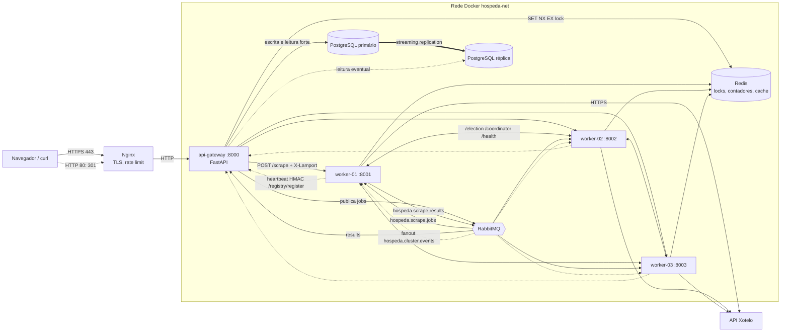
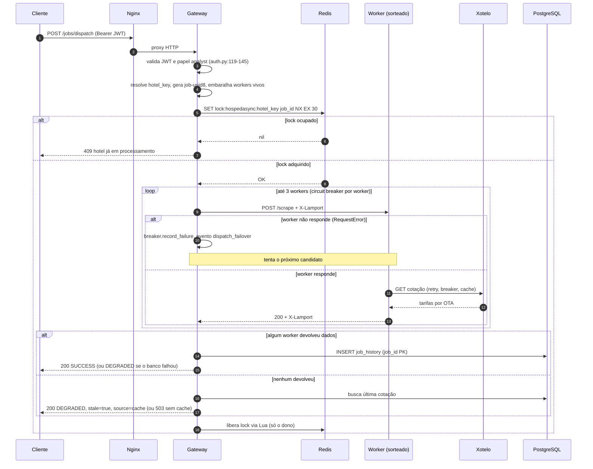
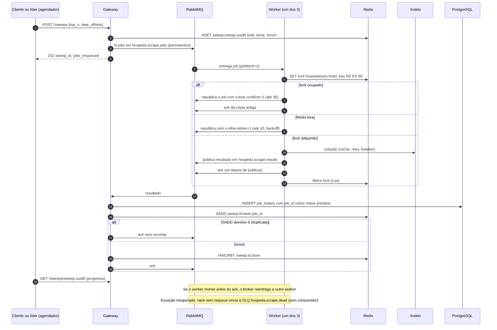
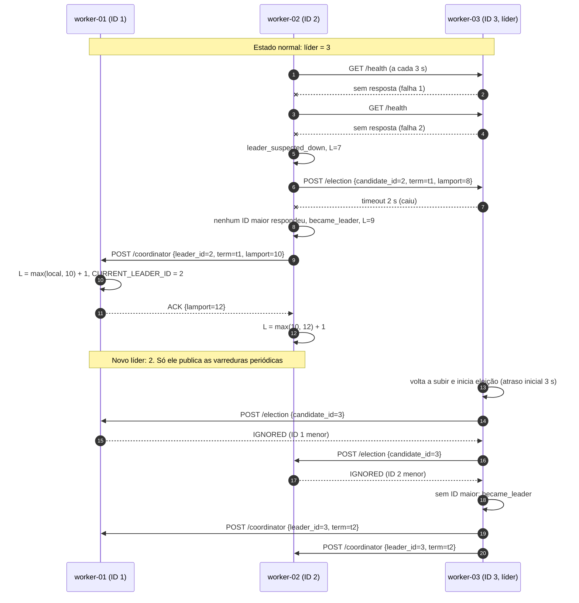
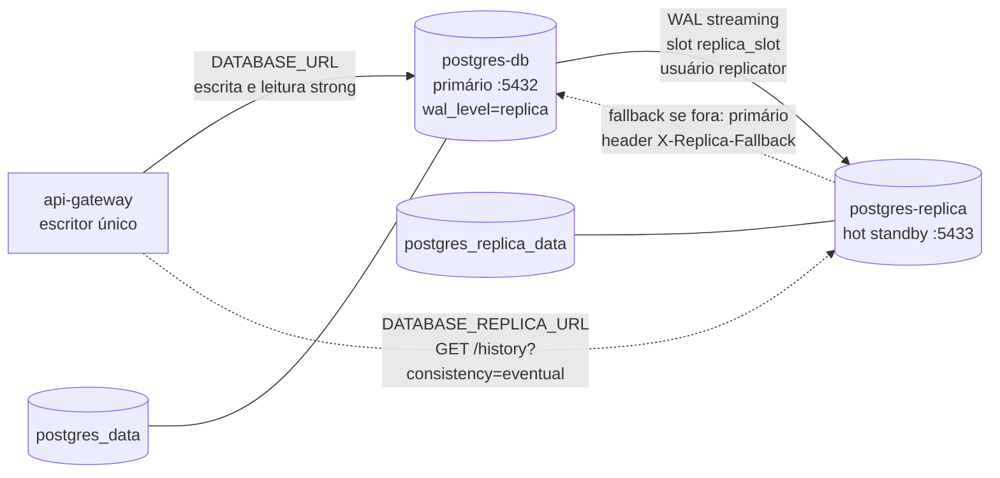

# Arquitetura do HospedaSync

Plataforma distribuída de monitoramento de tarifas hoteleiras. Coleta cotações reais de hotéis do Rio de Janeiro pela API Xotelo, distribui o trabalho entre três workers, guarda o histórico em PostgreSQL replicado e expõe um painel web autenticado.

## 1. Estilo arquitetural e justificativa

**Estilo:** microsserviços com API Gateway e pool de workers, combinado com arquitetura orientada a eventos (event-driven) pela fila RabbitMQ.

| Decisão | Justificativa | Evidência |
|---|---|---|
| Gateway como ponto único de entrada (REST) | Concentra autenticação, autorização, persistência e métricas; esconde os workers do cliente | `api-gateway/main.py:36-40` |
| Workers sem estado de negócio, com escala horizontal | Qualquer worker executa qualquer job; adicionar um `worker-NN` não muda código | `docker-compose.yml:126`, `:160`, `:194` |
| Fila para varreduras (event-driven) | A cotação demora cerca de 4 s e é I/O. A fila desacopla quem pede de quem executa, absorve picos e reentrega o job se o worker morrer | `shared/mq.py:41-53`, `workers/consumer.py:53-107` |
| REST síncrono para consulta pontual | Quem pede uma cotação de um hotel quer a resposta na mesma chamada | `api-gateway/main.py:364` |
| Banco como escritor único (gateway) | Evita conflito de escrita; workers apenas publicam resultados | `api-gateway/sweeps.py:239-260` |
| Coordenação entre pares (Bully + Redis) | Eleição do agendador e exclusão mútua por hotel sem componente central de coordenação além do Redis | `workers/election.py`, `shared/distlock.py` |

Por que não um monólito: a coleta é lenta e paralelizável, as falhas precisam ficar isoladas (um worker caindo não derruba o painel) e o enunciado exige coordenação entre nós. Por que não mais serviços: o domínio é pequeno; separar além de gateway e worker aumentaria a operação sem ganho didático.

Middleware de comunicação: **RabbitMQ (AMQP)** para a via assíncrona, **HTTP/REST (FastAPI, httpx)** para a síncrona, **Nginx** na borda.

## 2. Visão de componentes e rede

Portas publicadas no host: 80 e 443 (Nginx) para qualquer origem; 8000, 8001 a 8003, 5432, 5433, 6379, 5672 e 15672 apenas em `127.0.0.1` (`docker-compose.yml:19`, `:41`, `:69`, `:81-82`, `:97`, `:132`, `:166`, `:200`, `:232-233`).

## 3. Fluxo síncrono: `POST /jobs/dispatch` com lock e failover

Código: `api-gateway/main.py:364-496`.

Pontos de atenção: 502 ou 503 do worker (fonte fora) interrompe o laço sem tentar outro worker, mas conta para o breaker (`main.py:423-427`). O lock é sempre liberado no `finally` (`main.py:495-496`).

## 4. Fluxo assíncrono: varredura via RabbitMQ com resultado idempotente

Código: `api-gateway/sweeps.py:78-142` (publicação), `workers/consumer.py:53-107` (execução), `api-gateway/sweeps.py:194-260` (resultado).

Garantia: entrega **at-least-once** com gravação **idempotente**, que produz efeito exatamente-uma-vez no banco e nos contadores. O custo é que o scrape pode rodar duas vezes (consulta extra à Xotelo).

## 5. Eleição Bully com relógio de Lamport

Código: `workers/election.py:93-114` (recepção), `:127-151` (`become_leader`), `:154-197` (`start_election`), `:205-232` (`monitor_leader`). Relógio: `shared/lamport.py`.

Valores de L do diagrama são ilustrativos; as regras reais são: evento local ou envio faz `L = L + 1`; recebimento faz `L = max(L, recebido) + 1`. `GET /coordination/events` junta os logs de todos os nós ordenados por `(lamport, nó, horário físico)` (`shared/lamport.py:70-73`).

Parâmetros: eleição inicial 3 s após subir, timeout de 2 s por requisição, heartbeat do líder a cada 3 s, 2 falhas consecutivas disparam nova eleição (`election.py:18-21`). O `term` é `time.time()` (`election.py:161`) para que um líder que reinicia não seja descartado como obsoleto (`election.py:106-109`).

Limites: sem quórum (numa partição surgem dois líderes); o líder não participa do roteamento do dispatch.

## 6. Topologia de replicação PostgreSQL

| Item | Valor | Fonte |
|---|---|---|
| Replicação | streaming assíncrona, hot standby | `docker-compose.yml:12-21`, `deploy/postgres/replica-entrypoint.sh` |
| Usuário e regra | `replicator`; `host replication replicator all scram-sha-256` | `deploy/postgres/01-replicator.sh` |
| Carga inicial da réplica | `pg_basebackup -R -X stream -C -S replica_slot` | `deploy/postgres/replica-entrypoint.sh` |
| Leitura forte (padrão) | primário | `api-gateway/database.py:96-120` |
| Leitura eventual | réplica, com fallback e headers `X-Served-By`, `X-Replication-Lag-Ms` | `api-gateway/main.py:278-306` |
| Estado | `GET /consistency/status` (lag em ms e bytes, `sync_state`) | `api-gateway/database.py:132-163` |
| Failover | **manual** (`SELECT pg_promote()`); não há Patroni | `docs/notas/2026-11-09-replicacao-consistencia.md` |

Resultados medidos (N=50, `docs/felipe/resultados_consistencia.md`): leituras obsoletas 49/50 no modo assíncrono e 0/50 no modo forte (`remote_apply`); escrita média 0,80 ms contra 1,47 ms (custo de 1,8 vez); com a réplica parada, o commit forte bloqueou até o cancelamento do cliente aos 5 s e o assíncrono concluiu em 0,002 s.

CAP e PACELC: padrão PA/EL (replica assíncrona, escrita rápida), com PC/EC nas leituras do painel, que vão ao primário.

## 7. Fluxos de comunicação

| Origem | Destino | Protocolo | Formato | Autenticação |
|---|---|---|---|---|
| Navegador / curl | Nginx | HTTPS (TLS 1.2/1.3) na 443; HTTP na 80 redireciona (301) | JSON, HTML | Nenhuma na borda; limite de requisições por IP |
| Nginx | Gateway | HTTP | JSON | Repassa o cabeçalho `Authorization` |
| Cliente | Gateway (rotas protegidas) | HTTP/REST | JSON | JWT HS256 no `Authorization: Bearer`; papel `analyst` ou `admin` |
| Cliente | `POST /auth/login` | HTTP/REST | JSON | Usuário e senha (Argon2); 5 falhas por minuto bloqueiam |
| Gateway | Worker `POST /scrape` | HTTP/REST (httpx, timeout 50 s) | JSON + cabeçalho `X-Lamport` | HMAC-SHA256 por requisição (id, método, caminho, timestamp; janela de 60 s) |
| Worker (líder) | Gateway `GET /internal/hotels` | HTTP/REST a cada varredura | JSON | HMAC-SHA256 (mesmos cabeçalhos), recurso `internal:hotels` |
| Worker | Gateway `POST /registry/register` | HTTP/REST a cada 5 s | JSON | HMAC-SHA256 em `X-Service-Id`, `X-Timestamp`, `X-Service-Signature` com `SERVICE_SECRET`, janela de 60 s |
| Worker | Worker `/election`, `/coordinator`, `/health`, `/leader`, `/events` | HTTP/REST | JSON com campo `lamport` | HMAC-SHA256 por requisição (`/health` é público) |
| Gateway | Worker `/leader`, `/events` (diagnóstico) | HTTP/REST (timeout 1,5 s) | JSON | HMAC-SHA256 por requisição |
| Gateway / Worker | RabbitMQ | AMQP 0-9-1 (aio-pika) | JSON, mensagens persistentes | Usuário e senha do broker (`RABBITMQ_URL`) |
| Worker (líder) | Todos os workers | AMQP fanout `hospeda.cluster.events` | JSON (`type`, `node`, `lamport`) | Idem broker |
| Gateway / Worker | Redis | RESP | chave `lock:hospedasync:<hotel_key>`, `sweep:<id>` | `requirepass` (`REDIS_PASSWORD`) |
| Gateway | PostgreSQL primário | TCP (psycopg2) | SQL | Senha do usuário `postgres` |
| Réplica | Primário | Protocolo de replicação | WAL | Usuário `replicator` (SCRAM-SHA-256) |
| Worker | Xotelo | HTTPS | JSON | Nenhuma (API pública, sem chave) |

Observação: TLS cobre apenas a borda. O tráfego interno (HTTP, AMQP, RESP, SQL) trafega em claro dentro da rede Docker `hospeda-net`.

## 8. Esquema de nomes e identificadores

| Identificador | Formato | Quem gera | Por quê |
|---|---|---|---|
| Worker | `worker-NN` (`worker-01`) | Configuração (`WORKER_ID` no compose) | O sufixo numérico vira o ID do Bully (`election.py:44-49`): maior número, maior prioridade. Nenhuma tabela de IDs para manter e legível em log. `PEER_WORKERS` também aceita `id=url`, para hosts com IP em vez de nome |
| Job | `job-<uuid8>` (8 primeiros hex do UUID4) | Gateway (`main.py:381`, `sweeps.py:112`) | Único sem coordenação central, curto para digitar na demonstração. É a chave primária do histórico, base da idempotência. Com 32 bits a colisão é improvável nesta escala, mas não impossível em escala maior |
| Varredura | `sweep-<uuid8>` | Gateway (`sweeps.py:104`) ou líder (`scheduler.py:68`) | Agrupa os jobs; chave dos contadores no Redis |
| Lock | `lock:hospedasync:<hotel_key>` | `shared/distlock.py:14`, `:33` | Prefixo evita colisão com outras chaves do Redis; chave por `hotel_key` (e não por nome) evita que dois nomes diferentes do mesmo hotel contornem o lock |
| Contadores de varredura | `sweep:<sweep_id>` e `sweep:<sweep_id>:seen` | `sweeps.py:224-228` | Progresso e deduplicação |
| Hotel | `hotel_key` do TripAdvisor, `g303506-dNNNN` (`g303506` é o Rio de Janeiro, `dNNNN` o hotel) | Origem externa (Xotelo), carregado de `api-gateway/data/hotels_rio.json` | Identificador estável e único; a Xotelo e o link do TripAdvisor usam o mesmo código; dispensa mapeamento próprio |
| Filas e exchanges | `hospeda.scrape.jobs`, `hospeda.scrape.results`, `hospeda.scrape.dead`, `hospeda.dlx`, `hospeda.cluster.events` | `shared/mq.py:20-24` | Prefixo `hospeda.` isola o domínio no broker; o terceiro segmento diz a função |
| Serviços na rede | `api-gateway`, `worker-01`, `redis-lock`, `rabbitmq`, `postgres-db`, `postgres-replica` | DNS interno do Docker | Descoberta de endereço sem configuração de IP |
| Registry de nós | Dicionário `worker_id -> {endpoint, last_seen}` em memória | Gateway (`main.py:197-205`) | Descoberta dinâmica de workers vivos; expira em 15 s sem heartbeat |

## 9. Segurança em camadas

| Camada | Mecanismo | Referência |
|---|---|---|
| Borda | TLS 1.2/1.3, HSTS, CSP, `X-Frame-Options`, rate limit (20 req/s geral, 5 req/min no login) | `deploy/nginx/nginx.conf:14-15`, `:35`, `:42-46` |
| Usuário | JWT HS256 com expiração de 30 min, Argon2 nas senhas, limite de tentativas | `api-gateway/auth.py:24-35`, `:75-79`, `:91-99` |
| Autorização | Papéis `analyst` e `admin`; papel lido do banco | `api-gateway/auth.py:119-145`, `docs/seguranca/matriz-autorizacao.md` |
| Nó a nó | HMAC-SHA256 no registro de worker e na consulta do catálogo pelo agendador | `shared/servicetoken.py` |
| Segredos | `.env` gerado, fora do git; Redis, RabbitMQ e Postgres com senha | `scripts/gen_env.sh`, `docker-compose.yml` |
| Rede | Portas internas ligadas a `127.0.0.1` | `docker-compose.yml` |

Lacunas declaradas: sem TLS interno nem mTLS (o canal interno é HTTP com assinatura HMAC; o MAC não cobre o corpo); segredo JWT único; sem revogação individual de token.

## 10. Limitações da arquitetura

Redis, RabbitMQ e gateway em instância única; PostgreSQL sem failover automático; Bully sem quórum; DLQ sem consumidor; registry em memória; implantação AWS multi-instância não realizada. Detalhe e status em `docs/relatorio/matriz-requisitos.md`.
